# 🛠️ Awesome-Developer-Utilities-Swiss-Army-Knife

  

## 🌐 Top Developer Utilities & Swiss-Army Knife Ecosystem

**Curated List of SaaS/Hosted Platforms & Open-Source GitHub Projects**  
*Focused on All-in-One Developer Toolboxes, Self-Hosted Web Utilities, Offline Data Encoders/Decoders, Payload Formatters, Local Network Helpers & Multi-Tool Scratchpads.*

**Last updated: November 2026**

---

### 🔍 Overview & SEO Highlights
Welcome to the definitive, curated index of **Developer Utilities & Swiss-Army Knives**! Whether you are a full-stack engineer, DevOps/SRE, security analyst, or homelab self-hoster, this repository tracks tools that encode, decode, format, validate, hash, diff, convert, inspect, and benchmark JSON, YAML, JWTs, SQL, Base64, regular expressions, images, PDF documents, and cryptographic payloads.

- **Offline-First Security & Privacy**: Eliminate sensitive data leaks by utilizing client-side WebAssembly apps and local desktop native binaries.
- **Docker & Homelab Ready**: Deploy turnkey web utility dashboards (`IT-Tools`, `CyberChef`, `Stirling-PDF`, `OmniTools`) behind your reverse proxies.
- **Terminal & TUI Efficiency**: Supercharge command-line workflows with interactive terminals (`jq`, `yq`, `fx`, `Posting`, `difftastic`).

---

## 📑 Table of Contents

- [📊 Sector Overview & Market Dynamics](#-sector-overview--market-dynamics)
- [☁️ SaaS & Hosted Platforms](#️-saas--hosted-platforms)
- [💻 Open-Source GitHub Projects](#-open-source-github-projects)
- [🤝 How to Contribute](#-how-to-contribute)
- [💖 Support](#-support)
- [📜 Star History](#-star-history)
- [⚠️ Disclaimer](#️-disclaimer)

---

## 📊 Sector Overview & Market Dynamics

The global core software developer tools and application development software market is estimated at **$7.5B to $260B+** (with core coding, testing, and debugging developer utilities accounting for ~$7.5B in 2024–2026 and growing at an ~16% CAGR toward $16B+ by 2030). The developer utility and Swiss-army knife sector remains **moderately to highly fragmented** rather than a winner-take-all monopoly: while enterprise heavyweights (like Postman and Retool) dominate integrated enterprise workflows and API management, long-tail micro-utilities, niche offline desktop apps, and self-hosted open-source dashboards thrive independently due to strict developer privacy, offline compliance, and localized team needs.

---

## ☁️ SaaS & Hosted Platforms

The following SaaS and hosted platforms offer all-in-one developer utilities, internal dashboards, cloud formatters, and online playgrounds. Sorted by company scale (Valuation / Revenue) descending:

| SaaS Platform 🚀 | Scale (Valuation / Revenue) 🏢 | Starting Pricing Tier 💳 | Free Tier / Trial Limits 🎁 | Description 📝 |
| :--- | :--- | :--- | :--- | :--- |
| **[Postman](https://www.postman.com)** | **$5.6B Valuation** (~$313M ARR) | **$14/user/month** (Basic plan billed annually) | **Free Forever plan**: Capped at up to 3 team members, 25 collections, and 1,000 cloud API calls/month. | Collaborative API client platform offering request builders, mock servers, automated testing suites, and developer debugging environments. |
| **[Retool Utilities](https://retool.com)** | **$3.2B Valuation** (~$120M–$138M ARR) | **$10/user/month** (Team plan billed annually) | **Free Forever plan**: Supports up to 5 users total, 500 workflow runs/month, 250 AI credits/month, 20 agent hours/month, and 5GB database/file storage. | Hosted developer utilities alongside rapid low-code dashboard builders for JSON formatting, SQL generation, cron parsing, and backend workflows. |
| **[WebFX Tools](https://www.webfx.com)** | **~$168M–$284M Revenue** (~750+ employees) | **$500/month** (Starting agency tier) | **Free Forever plan**: 100% free web utilities directly in-browser with unlimited client-side runs (HTML/CSS/JS minifiers, `.htaccess` generators, schema builders). | Web agency digital toolbox offering browser-based minifiers, schema generators, SEO payload validators, and encoding helpers. |
| **[ToolJet Cloud](https://tooljet.com)** | **~$8.5M ARR** ($6.15M+ funding) | **$19/builder/month** (Basic plan billed annually) | **Free Forever plan**: Capped at 2 builders, up to 50 end-users, 2–3 active applications, and 100 AI credits/month. | Open-source backed low-code internal tool platform offering hosted web utilities, database inspectors, and reactive dashboards. |
| **[Regex101](https://regex101.com)** | **~$600K–$1M ARR** (Bootstrapped / Indie) | **€4.99/month** (€59.88/year billed annually) | **Free Forever plan**: Unlimited basic pattern matching, code generation, up to 2 test strings, and a 50-step debugger execution trace limit. | Browser-hosted regular expression testing, debugging, and visualization suite supporting PCRE, JavaScript, Python, and Golang flavors. |
| **[ExtendsClass](https://extendsclass.com)** | **~$200K ARR** (Bootstrapped / Ads & Pro) | **$5/month** ($39/year for SafeJSON Pro) | **Free Forever plan**: Unlimited client-side formatters and validators, capped at 10,000 requests/month for free mock API and JSON storage endpoints. | Online developer playground and utility suite featuring JSON/XML/SQL validators, visual diff checkers, regex testers, and mock HTTP sandboxes. |
| **[DevUtils](https://devutils.com)** | **~$60K ARR** ($5K/month bootstrapped) | **$29 one-time** (Perpetual license for 1 Mac) | **14-day free trial**: Fully functional trial with all 45+ tools unlocked, followed by a demo mode with periodic activation reminders. | Native macOS offline developer Swiss-army knife featuring 45+ tools (JWT debugger, JSON/YAML/SQL formatters, timestamp converter) with smart clipboard auto-detection. |

---

## 💻 Open-Source GitHub Projects

Curated open-source projects for self-hosted web developer Swiss-army knives, offline desktop applications, and terminal/TUI utilities. Sorted by GitHub Star Count descending:

- **[Excalidraw (`excalidraw/excalidraw`)](https://github.com/excalidraw/excalidraw)**   
  Virtual collaborative whiteboard & sketch diagramming scratchpad.

- **[LocalSend (`localsend/localsend`)](https://github.com/localsend/localsend)**   
  Cross-platform, open-source secure local network file & text sharing.

- **[Stirling-PDF (`Stirling-Tools/Stirling-PDF`)](https://github.com/Stirling-Tools/Stirling-PDF)**   
  Self-hosted Docker Swiss-army knife for PDF merging, splitting, OCR, and editing.

- **[Uptime Kuma (`louislam/uptime-kuma`)](https://github.com/louislam/uptime-kuma)**   
  Self-hosted monitoring utility dashboard with alerts and status pages.

- **[Hoppscotch (`hoppscotch/hoppscotch`)](https://github.com/hoppscotch/hoppscotch)**   
  Lightweight, Git-friendly open-source API development & testing suite.

- **[Bruno (`usebruno/bruno`)](https://github.com/usebruno/bruno)**   
  Offline-first, open-source desktop API client storing collections in plain files.

- **[IT-Tools (`CorentinTh/it-tools`)](https://github.com/CorentinTh/it-tools)**   
  Flagship self-hosted web collection of 80+ handy utilities for developers & IT pros.

- **[Insomnia (`Kong/insomnia`)](https://github.com/Kong/insomnia)**   
  Open-source desktop API design, debugging, and mock client platform.

- **[CyberChef (`gchq/CyberChef`)](https://github.com/gchq/CyberChef)**   
  GCHQ Cyber Swiss Army Knife for encryption, encoding, compression & forensic recipes.

- **[jq (`jqlang/jq`)](https://github.com/jqlang/jq)**   
  Command-line JSON processor and transformation Swiss-army knife.

- **[Web-Check (`Lissy93/web-check`)](https://github.com/Lissy93/web-check)**   
  All-in-one OSINT and web infrastructure analyzer inspecting DNS, SSL, and server headers.

- **[Delta (`dandavison/delta`)](https://github.com/dandavison/delta)**   
  Syntax-highlighting, paging pager for git, diff, and grep output.

- **[DevToys (`DevToys-app/DevToys`)](https://github.com/DevToys-app/DevToys)**   
  Cross-platform offline developer Swiss-army knife with smart clipboard inspection.

- **[Difftastic (`Wilfred/difftastic`)](https://github.com/Wilfred/difftastic)**   
  Structural syntax-aware diff tool computing diffs based on ASTs rather than lines.

- **[Squoosh (`GoogleChromeLabs/squoosh`)](https://github.com/GoogleChromeLabs/squoosh)**   
  Browser-based image optimization and format converter running offline via WebAssembly.

- **[fx (`antonmedv/fx`)](https://github.com/antonmedv/fx)**   
  Interactive terminal JSON viewer, slice-and-dice processor, and stream explorer.

- **[yq (`mikefarah/yq`)](https://github.com/mikefarah/yq)**   
  Portable command-line YAML, JSON, XML, CSV, and TOML processor.

- **[Dozzle (`amir20/dozzle`)](https://github.com/amir20/dozzle)**   
  Real-time lightweight Docker container log viewer and process statistics monitor.

- **[Posting (`darrenburns/posting`)](https://github.com/darrenburns/posting)**   
  Modern terminal TUI HTTP API client with autocompletion and environment configurations.

- **[OmniTools (`iib0011/omni-tools`)](https://github.com/iib0011/omni-tools)**   
  Self-hosted all-in-one browser toolsuite for media, PDF, and code transforms.

- **[Transform (`ritz078/transform`)](https://github.com/ritz078/transform)**   
  Polyglot web converter turning JSON to TS/Rust/Go, SVG to JSX, and schema formats.

- **[Mermaid Live Editor (`mermaid-js/mermaid-live-editor`)](https://github.com/mermaid-js/mermaid-live-editor)**   
  Browser-based live scratchpad for rendering diagrams from text definitions.

- **[Boop (`IvanMathy/Boop`)](https://github.com/IvanMathy/Boop)**   
  Extensible scriptable scratchpad for macOS with JavaScript transformation scripts.

---

## 🤝 How to Contribute

Contributions are warmly welcomed! Help make developer utilities and Swiss-army knife toolboxes more accessible, privacy-focused, and comprehensive:

1. 🍴 **Fork the repo**.
2. 🌿 **Create a new branch**: `git checkout -b feature/add-new-utility`.
3. ✍️ **Add or edit entries** in `README.md` (keep alphabetical or star-sorted formatting, include badges and specific pricing/free-tier details).
4. 🚀 **Submit a Pull Request** with a clear explanation of why the tool belongs in this Swiss-army knife curated collection.

---

## 💖 Support

Thank you for visiting and using this curated developer utilities guide! If you find this project valuable for your daily development workflows, homelab, or team toolsets, your support is truly appreciated and helps keep this list up to date and comprehensive:

- ⭐ **Star this repository**: It only takes a second and helps boost visibility across the developer community.
- 🍴 **Fork the project**: Keep a personal copy and contribute your favorite developer utilities back via Pull Requests.
- 📢 **Share with others**: Recommend this repository to your friends, coworkers, engineering teams, and community on X/Twitter, LinkedIn, Reddit, or Discord.
- ☕ **Buy me a coffee**: If you'd like to support ongoing open-source maintenance, research, and curation, consider buying me a coffee or sponsoring through the [GitHub Sponsor Dashboard](https://github.com/sponsors/ishandutta2007).

---

## 📈 Star History

---

## ⚠️ Disclaimer

- This is a **community-curated list** — entries are listed for informational purposes and do not represent a commercial endorsement.
- 🔒 **Security Notice**: Never paste production JWT secrets, private SSH/RSA keys, API tokens, or customer PII into third-party hosted cloud utilities. Always rely on offline desktop software (`DevToys`, `Boop`, CLI tools) or locally-hosted Docker instances (`IT-Tools`, `CyberChef`, `OmniTools`).
- 🛡️ **Network Notice**: Self-hosted portals (`IT-Tools`, `Stirling-PDF`, `Web-Check`) exposed to the public internet should always be secured behind HTTPS/TLS reverse proxies with multi-factor authentication.
